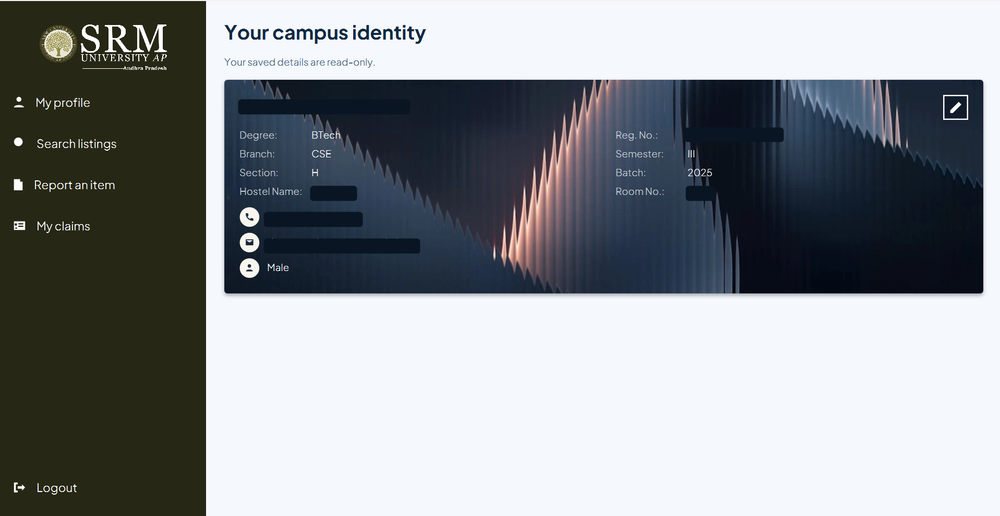
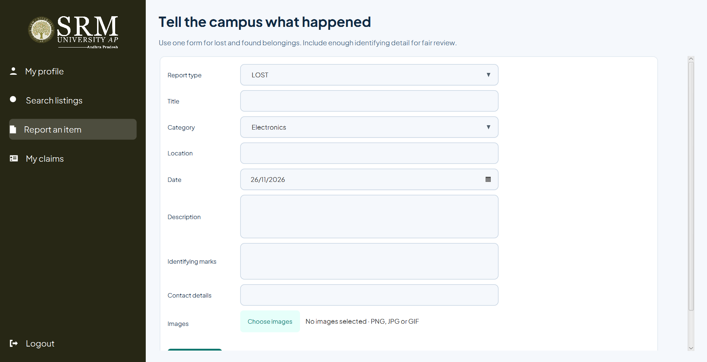
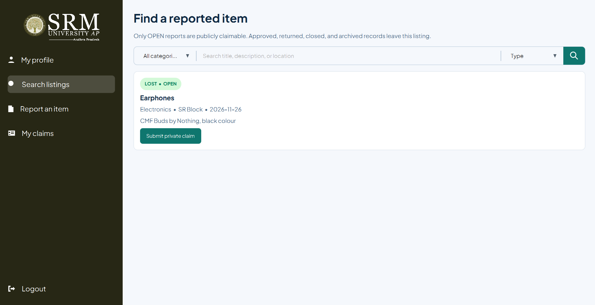
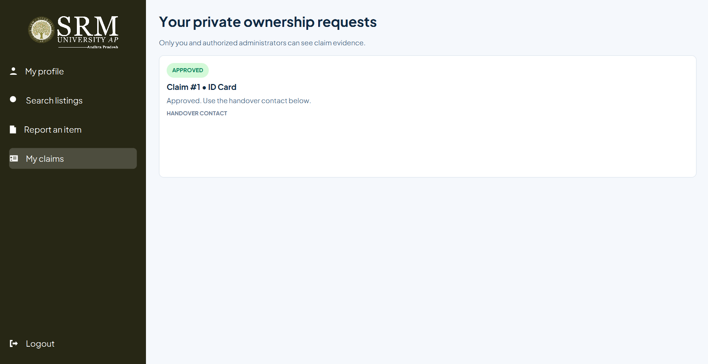
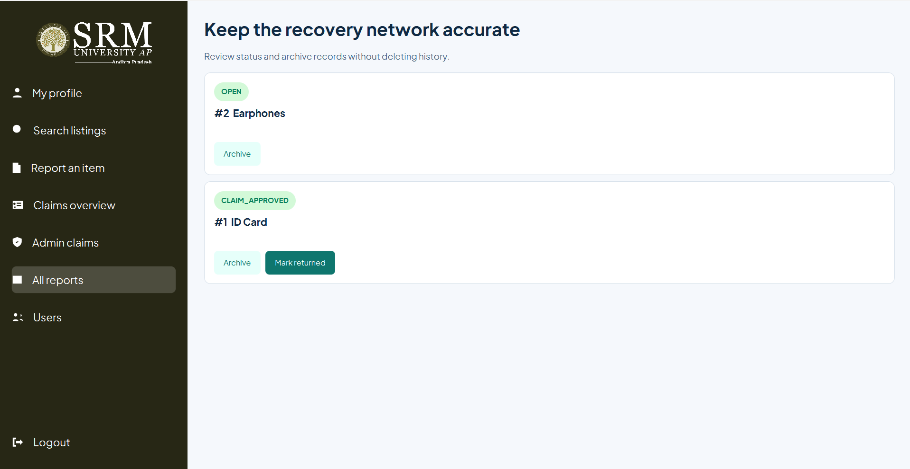

# SRM AP Lost and Found

**CSE 213 · Advanced Java Programming · Course project**

A campus lost and found application presented here as a compact Java coursework showcase. Screenshots show the finished interface; selected source files show where course concepts appear in the implementation.

> **Presentation snapshot:** this repository is curated for review, not packaged to download or run. Build scripts, database setup, UI assets, and supporting application files are intentionally omitted.

## Project at a glance

Students can report lost or found belongings, search open listings, and submit private ownership claims. Administrators can review claims and update report status.

<table>
  <tr>
    <td align="center"> Sign in</td>
    <td align="center"> Campus profile</td>
  </tr>
  <tr>
    <td align="center"> Report an item</td>
    <td align="center"> Search listings</td>
  </tr>
  <tr>
    <td align="center"> Ownership requests</td>
    <td align="center"> Manage reports</td>
  </tr>
</table>

## Java concepts mapped to CSE 213

| Course area | Evidence in this project | What the code demonstrates |
|---|---|---|
| Classes, objects, constructors, encapsulation | [`User.java`](src/main/java/com/campus/lostfound/domain/model/User.java#L7) | A class stores user data in private fields and exposes it through methods. |
| Enums, collections, decisions, exceptions | [`ItemStatusService.java`](src/main/java/com/campus/lostfound/service/ItemStatusService.java#L10) · [`ItemStatus.java`](src/main/java/com/campus/lostfound/domain/enums/ItemStatus.java) | A `Map` of `Set`s defines allowed status changes; conditions reject invalid transitions. |
| Validation and custom exceptions | [`ItemService.java`](src/main/java/com/campus/lostfound/service/ItemService.java#L43) · [`ValidationException.java`](src/main/java/com/campus/lostfound/exception/ValidationException.java) | Input checks stop incomplete reports with a project-specific exception. |
| Interfaces and polymorphism | [`ItemRepository.java`](src/main/java/com/campus/lostfound/repository/api/ItemRepository.java#L10) · [`JdbcItemRepository.java`](src/main/java/com/campus/lostfound/repository/jdbc/JdbcItemRepository.java#L16) | Services depend on a repository interface; JDBC supplies its implementation. |
| JDBC and resource handling | [`JdbcItemRepository.java`](src/main/java/com/campus/lostfound/repository/jdbc/JdbcItemRepository.java#L20) | Prepared statements perform database work, and try-with-resources closes connections and statements. The project uses MySQL; the course outline names SQLite. |
| JavaFX, inheritance, event handling, lambdas | [`App.java`](src/main/java/com/campus/lostfound/App.java#L31) · [login action](src/main/java/com/campus/lostfound/App.java#L69) | The application extends JavaFX `Application` and connects button events to actions. |
| Collections, streams, and generics | [image selection](src/main/java/com/campus/lostfound/App.java#L160) · [background task](src/main/java/com/campus/lostfound/App.java#L320) | Lists hold selected paths; streams transform them; `Task<T>` carries a typed result. |
| Threads and file I/O | [background task and file copy](src/main/java/com/campus/lostfound/App.java#L318) | Database work runs in a worker thread, while selected images are copied to storage. |

### Scope notes

- Java records appear in [`Item.java`](src/main/java/com/campus/lostfound/domain/model/Item.java) and [`UserProfile.java`](src/main/java/com/campus/lostfound/domain/model/UserProfile.java). They are used by the project, but are not called out as a separate topic in the supplied CSE 213 outline.
- The JavaFX `Task<T>` example demonstrates background work in this GUI. It is not a small standalone example of creating a thread from scratch.
- This is evidence of concepts used in the project, not a claim that every implementation detail was taught in class.

## Selected source

- **Models and types:** `domain/model/`, `domain/enums/`
- **Rules and validation:** `service/ItemService.java`, `service/ItemStatusService.java`, `validation/EmailValidator.java`
- **Database abstraction:** `repository/api/ItemRepository.java`, `repository/jdbc/JdbcItemRepository.java`
- **Desktop UI and integration:** `App.java`

## Credits

Course project by the student team, Department of Computer Science and Engineering, SRM University–AP.
