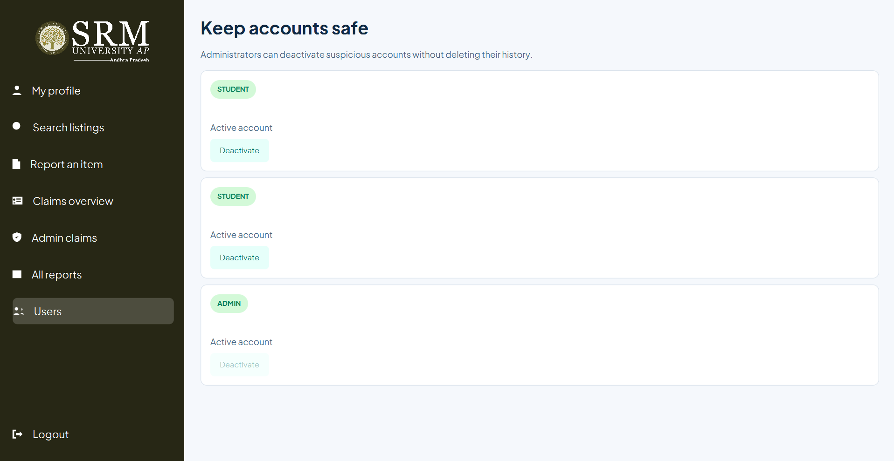

# SRM AP Lost and Found Management

**A JavaFX desktop app for reporting lost and found items, searching campus listings, and managing ownership claims.**

<p align="center">
  
</p>

## Features

- Students can report items with photos, search open listings, submit private claims, and manage their profile.
- Administrators can review claims, manage accounts, and update return or archive status.
- MySQL stores account, profile, report, and claim data; uploaded images are stored as files with database references.

## Screenshots

Personal account and contact values are hidden in the screenshots below.

### Student

<table>
  <tr>
    <td align="center" width="50%"><br><sub>Profile</sub></td>
    <td align="center" width="50%"><br><sub>Report an item</sub></td>
  </tr>
  <tr>
    <td align="center" width="50%"><br><sub>Search listings</sub></td>
    <td align="center" width="50%"><br><sub>My claims</sub></td>
  </tr>
</table>

### Administrator

<table>
  <tr>
    <td align="center" width="50%"><br><sub>Review and manage reports</sub></td>
    <td align="center" width="50%"><br><sub>Manage accounts</sub></td>
  </tr>
</table>

## Run on Windows

You need JDK 21 or newer, a running MySQL server, and a `campus_app` database account. Run [`schema.sql`](src/main/resources/database/schema.sql) as a database administrator, then launch from the project folder:

```powershell
.\scripts\run-app.ps1
```

The launcher requests the database password securely for that run. Never commit passwords or real user details.

## Project map

| Area | Location |
| --- | --- |
| JavaFX screens and user actions | [`App.java`](src/main/java/com/campus/lostfound/App.java) |
| Data models and status types | [`domain/model`](src/main/java/com/campus/lostfound/domain/model) · [`domain/enums`](src/main/java/com/campus/lostfound/domain/enums) |
| Application rules | [`service`](src/main/java/com/campus/lostfound/service) |
| Storage contracts and MySQL/JDBC code | [`repository`](src/main/java/com/campus/lostfound/repository) |
| Database configuration | [`config`](src/main/java/com/campus/lostfound/config) · [`application.properties`](src/main/resources/application.properties) |
| Unit tests | [`src/test/java`](src/test/java) |

## Java concepts visible in the code

These links point to examples used by the application. Check them against the CSE 213 syllabus before presenting them as topics covered in class.

| Concept | Example in the source | In this project |
| --- | --- | --- |
| Classes, objects, constructors, and encapsulation | [`User.java`](src/main/java/com/campus/lostfound/domain/model/User.java#L7) · [`constructor`](src/main/java/com/campus/lostfound/domain/model/User.java#L15) | A user is represented by an object with private fields and accessors. |
| Records | [`UserProfile.java`](src/main/java/com/campus/lostfound/domain/model/UserProfile.java#L3) | A record holds a student's profile data. |
| Enums | [`Role.java`](src/main/java/com/campus/lostfound/domain/enums/Role.java#L3) | Roles and workflow states use a defined set of values. |
| Interfaces and implementations | [`ItemRepository.java`](src/main/java/com/campus/lostfound/repository/api/ItemRepository.java#L10) · [`JdbcItemRepository.java`](src/main/java/com/campus/lostfound/repository/jdbc/JdbcItemRepository.java#L16) | A storage contract is implemented using JDBC. |
| Collections and maps | [`ItemStatusService.java`](src/main/java/com/campus/lostfound/service/ItemStatusService.java#L11) | A map of sets lists the allowed item-status changes. |
| Conditions and exceptions | [`ItemStatusService.java`](src/main/java/com/campus/lostfound/service/ItemStatusService.java#L20) · [`ItemService.java`](src/main/java/com/campus/lostfound/service/ItemService.java#L43) | The app validates inputs and rejects invalid status changes. |
| Lambdas and event handlers | [`App.java`](src/main/java/com/campus/lostfound/App.java#L69) | A button action calls the sign-in workflow. |
| Streams and file paths | [`App.java`](src/main/java/com/campus/lostfound/App.java#L161) | Selected image files are converted to paths and previews. |
| Background tasks and threads | [`App.java`](src/main/java/com/campus/lostfound/App.java#L331) · [`App.java`](src/main/java/com/campus/lostfound/App.java#L355) | Database operations run outside the JavaFX UI thread. |
| JDBC and try-with-resources | [`JdbcItemRepository.java`](src/main/java/com/campus/lostfound/repository/jdbc/JdbcItemRepository.java#L22) | Prepared statements pass SQL values safely, and resources close automatically. |
